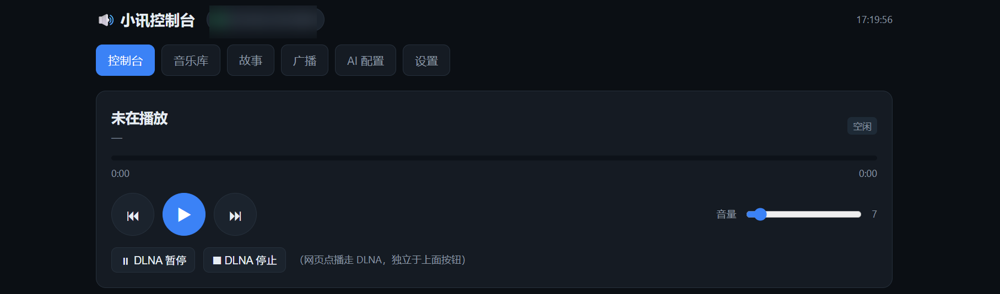

# r1-webui — Self-hosted AI backend & web console for the Phicomm R1 smart speaker

**English** | [简体中文](README.md)

[](LICENSE)
[](https://www.python.org/)

Turn a **Phicomm R1** (a cheap, discontinued Chinese smart speaker, RK3229 / Android 5.1) into a
fully self-hosted AI speaker: voice chat, weather, local music, audiobooks and internet radio —
all running on your own NAS/server, with no third-party relay in the loop.
Ships with a complete web console.

> Zero dependencies — Python standard library only. One command to start.



---

## Why this exists

The popular R1 mods (e.g. `r1-py` + a modified APK) have a catch:
**the author-hosted web UI hardcodes the "AI backend" URL to the author's own server.**
No matter what you type in that UI, your AI requests keep going through his relay.

This project does three things:

1. **Implements the AI backend yourself** — reproduces the Yunzhisheng (云知声) NLU protocol,
   so the LLM, weather and media all run on your machine.
2. **Bypasses the author's web UI** — configures the device through its local WebSocket protocol
   ([`r1_ctl.py`](r1_ctl.py)).
3. **Provides a web console** — status, playback control, library / audiobooks / radio,
   weather settings, AI config, all in one page.

---

## Features

### Voice (say to the speaker)
| Say | Action |
|---|---|
| 小讯小讯，讲个笑话 | AI chat |
| 小讯小讯，今天天气怎么样 | Weather (default location configurable) |
| 小讯小讯，播放周杰伦的歌 | Play local library (auto-builds a 100-track queue) |
| 小讯小讯，播放亚洲经典台 | Play internet radio (fuzzy name matching) |

### Web console
- **Console** — live status, play/pause/next/prev, volume, progress, recent history
- **Library** — all tracks (paging/search), ★ favourites, play history
- **Stories** — audiobooks / long audio (2 h+ with no limit), cast via DLNA
- **Radio** — station list, one-click play, add/remove your own stations
- **AI config** — backend URL, model, key, system prompt (what the author's UI won't let you do)
- **Settings** — weather location (city / lat-lon), built-in music & story sources

### Playback paths
- **Voice requests** → the device's internal player (via the `SETTING_EXEC` playlist)
- **Web play button** → DLNA casting (`AVTransport`), supports live streams, long files, seeking

---

## Requirements

- An always-on machine: NAS, mini-PC, Raspberry Pi or a VPS
- **Python 3.10+**
- An OpenAI-compatible LLM API key (DeepSeek / Qwen / GLM / local vLLM …)
- A **Phicomm R1** on stock firmware `3448` with the community-modified APK installed (see §3)

## Quick start

```bash
cd r1-webui
cp config.example.json config.json
vi config.json          # fill llm.api_key and media.public_base at minimum
python3 server.py
```

```
 R1 self-hosted AI backend started
   listen      : http://0.0.0.0:8866
   AI endpoint : http://<your-ip>:8866/r1/ai/chat/completions
   media root  : /path/to/music
```

Self-check:

```bash
curl http://127.0.0.1:8866/health
# {"ok": true, ...}
```

Run as a service:

```bash
sudo cp deploy/r1-webui.service /etc/systemd/system/
sudo vi /etc/systemd/system/r1-webui.service   # set User / WorkingDirectory
sudo systemctl daemon-reload && sudo systemctl enable --now r1-webui
```

## Device side

1. Verify firmware is `3448`: `adb shell getprop ro.build.version.incremental`
2. Install the community-modified APK (available in the author's public `r1-dummy` repo).
   This project does **not** bundle the APK or firmware — obtain it yourself and review it.
3. Opening `http://<speaker-ip>:18888` redirects to the author's web console.
   **Do not save the AI config there** — it pins the backend to the author's server.
4. Point the speaker at your own backend:

```bash
python3 r1_ctl.py --ip <speaker-ip>:18888 set-backend http://<your-server-ip>:8866
python3 r1_ctl.py --ip <speaker-ip>:18888 query
```

5. Open the console:

```
http://<your-server-ip>:8866/?ip=<speaker-ip>:18888
```

Pages: `/?ip=…` · `/lib?ip=…` · `/story?ip=…` · `/radio?ip=…` · `/ai?ip=…` · `/cfg?ip=…`

Then just say: **小讯小讯，讲个笑话**.

---

## Configuration

See [`config.example.json`](config.example.json) for the full annotated template.

Key points:

- `media.public_base` **must be reachable from the speaker** (LAN IP, not `127.0.0.1`).
- `media.roots` supports multiple directories; the first one (`key: ""`) is the primary library,
  others get an `@key/` URL prefix (used here to keep `audiobooks/` separate from music).
- `weather.lat` / `weather.lon` are recommended — Open-Meteo's Chinese geocoder is poor at
  county-level names, and public-IP geolocation usually only resolves to the provincial capital.
- `radio.stations` is a list of `{name, url}` — any direct `mp3`/`aac` live stream works.
- New media files are picked up automatically within `media.rescan_seconds` (default 60 s), no restart.

Supported audio: `mp3` `flac` `m4a` `aac` `wav` `ogg` `opus` `wma`

---

## Device protocol

One of the main contributions of this repo is a **complete write-up of the modified APK's protocol**,
including several pitfalls that silently break playback (e.g. a `SETTING_EXEC` response missing
`audioUrl` makes the device throw a `NullPointerException` inside its *weather* handler and the whole
event chain dies — the speaker then appears to ignore you).

See **[docs/PROTOCOL.md](docs/PROTOCOL.md)** (Chinese, with code-level detail).

Covers:

- AI endpoint contract (`POST /r1/ai/chat/completions`, `r1-serial` / `x-r1-ai` headers)
- Yunzhisheng NLU envelopes (`ANSWER` vs `SETTING_EXEC`) and every required field
- Device WebSocket control channel (`ws://<ip>:18888/ws/status`) — all actions and the `ai` save semantics
- DLNA/UPnP AVTransport casting (dynamic ports, live streams, transport state)
- Known firmware quirks

Troubleshooting: **[docs/TROUBLESHOOTING.md](docs/TROUBLESHOOTING.md)** (Chinese)

---

## Credits

- **[ring1012/r1-py](https://github.com/ring1012/r1-py)** — the original "AI on R1" edge service (MIT).
  The initial understanding of the protocol envelope and the `x-r1-ai` header came from it.
- **[ring1012/r1-dummy](https://github.com/ring1012/r1-dummy)** — publicly distributed `adb.exe` and APK bundle.
- The Enshan (恩山) forum and the wider R1 community — hardware info, firmware, DLNA behaviour, countless gotchas.
- **[Open-Meteo](https://open-meteo.com/)** — free, key-less weather and geocoding APIs.
- Everyone who brought the Phicomm R1 back from the dead.

> This project is not affiliated with the above; it contains none of their closed-source code or binaries.
> All protocol findings were independently reproduced and verified on real hardware.

## Disclaimer

- No closed-source APK, firmware, or third-party media service is bundled here.
- The community-modified APK is closed source and may include remote OTA — evaluate the risk yourself.
- Not affiliated with Phicomm or Yunzhisheng.
- Make sure you have the legal right to the music/radio content you play.

## License

[MIT](LICENSE)
